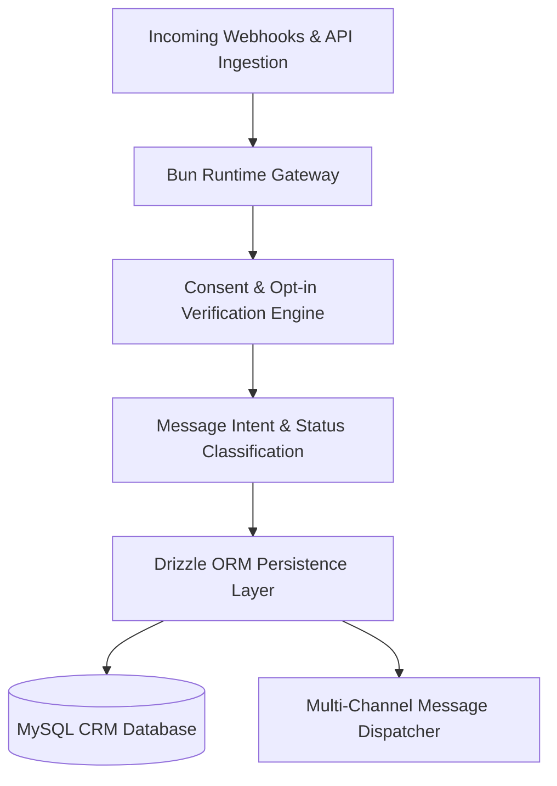

# Connect All Together

## Overview
Connect All Together is a full-stack, multi-channel customer communications and CRM orchestration platform. Built on Bun and TypeScript, it integrates database migrations, consent management, automated intent classification, and multi-channel message delivery into a unified architecture.

## System Architecture



## Core Features
- **Multi-Channel Dispatch**: Coordinated messaging workflows supporting SMS, email, and interactive customer messaging.
- **Consent Enforcement**: Regulatory consent tracking and audit logging to verify communication opt-ins before transmission.
- **Automated Intent Classification**: Categorization of incoming inbound communications to optimize agent routing.
- **Database Schema Migrations**: Type-safe schema definitions and automated versioned migrations powered by Drizzle ORM.

## Repository Structure
```
connect-all-together/
|-- drizzle/
|   |-- migrations/
|   |   |-- 0000_mysql_crm.sql
|   |   |-- 0002_add_consent_columns.sql
|   |   +-- 0003_add_message_status_and_intent.sql
|   +-- meta/
|-- components.json
|-- drizzle.config.ts
|-- AGENTS.md
|-- bun.lock
|-- bunfig.toml
+-- README.md
```

## Technology Stack
| Component | Technologies |
| :--- | :--- |
| Runtime | Bun |
| Language | TypeScript |
| ORM & Schema | Drizzle ORM |
| Database | MySQL |
| Validation | Zod |

## Installation & Execution
```bash
# Clone the repository
git clone https://github.com/sohailahmed-bsrh/connect-all-together.git
cd connect-all-together

# Install dependencies using Bun
bun install

# Run database migrations
bun run drizzle-kit migrate

# Start the application
bun run dev
```

---

## Author & Contact Information

<table width="100%" align="center">
  <tr>
    <td align="center" style="padding: 20px;">
      <h3>Sohail Ahmed</h3>
      <p><strong>Full-Stack Artificial Intelligence & Computer Vision Engineer</strong></p>
      <p>
        <a href="https://sohail.devsil.com"></a>
        <a href="https://github.com/sohailahmed-bsrh"></a>
        <a href="https://linkedin.com/in/sohail-ahmed-dev"></a>
        <a href="mailto:sohail.bsrh@gmail.com"></a>
      </p>
      <p><em>Available for technical roles in Artificial Intelligence, Computer Vision, and Full-Stack Engineering.</em></p>
      <hr style="border: 0; height: 1px; background: #30363d; margin: 15px 0;">
      <small>Distributed under the MIT License.</small>
    </td>
  </tr>
</table>
